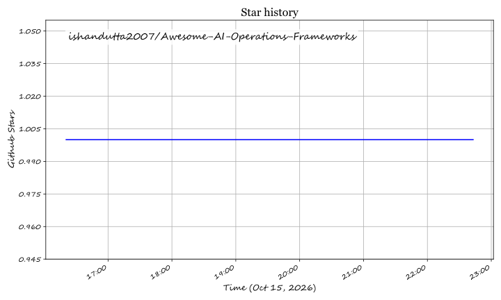

  

# 🚀 Awesome AI Operations Frameworks

  
  
  
  
  
  
  

## 🌐 Top AI Operations Frameworks Ecosystem

**Curated List of Production SaaS Products & Battle-Tested Open-Source GitHub Projects**  
*Focused on Agent Harness Operations, Infrastructure Automation, LLM Orchestration & Deployment Control Planes*  

📅 **Last updated:** October 2026

---

### 🔍 Overview

This repository is an authoritative directory tracking notable **SaaS platforms** and **open-source projects** for **AI Operations Frameworks (AIOps / LLMOps)**. These tools enable engineering, platform, and SRE teams to run AI agent harnesses reliably—provisioning scalable compute/GPU infrastructure, managing runtime agent state, orchestrating rolling zero-downtime upgrades, automating drift detection, and enforcing operational guardrails across development, staging, and high-concurrency production environments.

> 💡 **Open-source emphasis**: This collection is heavily expanded with premier active projects for self-hosting, agent harness operations, AI model serving, distributed batch execution, and open infrastructure automation—ideal for platform engineers, SREs, and developers seeking transparent, vendor-independent AI operations.

Contributions welcome! Open a PR to add or update entries. Please keep descriptions factual and link to official documentation.

---

## 📑 Table of Contents

- [📊 Sector Overview & Market Dynamics](#-sector-overview--market-dynamics)
- [☁️ SaaS/Hosted Platforms](#️-saashosted-platforms)
- [🛠️ Open-Source GitHub Projects](#️-open-source-github-projects)
- [🏗️ Architectural Blueprints for AI Operations](#️-architectural-blueprints-for-ai-operations)
- [📈 Star History](#-star-history)
- [🤝 Support](#-support)
- [🤝 How to Contribute](#-how-to-contribute)
- [⚠️ Disclaimer](#️-disclaimer)

---

## 📊 Sector Overview & Market Dynamics

The global AI Operations (AIOps) and automated IT Operations Management (ITOM) market is estimated at **$18B–$21B in 2026** and projected to surpass **$40B by 2030** (growing at a ~22–30% CAGR). The market structure is **moderately fragmented yet increasingly bifurcated**: hyperscalers (AWS, Azure, Google Cloud) dominate foundational native infrastructure operations in a semi-concentrated winner-take-most dynamic, while an active, fragmented ecosystem of independent multi-cloud orchestration and policy platforms (such as HashiCorp, Spacelift, and PagerDuty) competes aggressively for multi-cloud, vendor-neutral enterprise deployments.

---

## ☁️ SaaS/Hosted Platforms

| Platform | Company Scale (Valuation / Revenue) | Description | Pricing | Free Tier Limits |
| :--- | :--- | :--- | :--- | :--- |
| **[Azure Automation](https://azure.microsoft.com/en-us/products/automation/)** | **~$3.1T** Market Cap (Microsoft) / **$245B+** Revenue | Cloud-based process automation, runbooks, configuration management, and update orchestration across hybrid setups. | Process automation overage starts at **$0.002 per job run minute**; watcher overage at **$0.002 per hour**. | **Free forever**: **500 job run minutes** per subscription per month and **744 watcher hours** per month (capped at 50 concurrent jobs). |
| **[AWS Systems Manager](https://aws.amazon.com/systems-manager/)** | **~$2.0T** Market Cap (Amazon) / **$107B+** AWS Revenue | Unified operations hub for AWS and hybrid environments with Patch Manager, Run Command, State Manager, and Session Manager. | Core management is free; Advanced Parameter Store starts at **$0.05 per parameter/month** + $0.05/10k interactions; On-prem/hybrid instances managed at no additional SSM license fee. | **Free forever**: Core management features on EC2 & hybrid nodes are 100% free; up to **10,000 standard parameters** per region (up to 4 KB each) and standard throughput API calls. |
| **[Google Cloud Deployment Manager](https://cloud.google.com/deployment-manager)** | **~$2.0T** Market Cap (Alphabet) / **$40B+** GCP Revenue | Declarative infrastructure deployment service for defining and provisioning Google Cloud resources via YAML templates. | **$0.00** service charge (100% free tool; users only pay for the underlying Google Cloud compute, disk, and network resources provisioned). | **Free forever**: Tool usage is completely free up to **1,000 active deployments** per project, **1,000 write API requests/day**, and 20 requests/sec. |
| **[SaltStack Enterprise (VMware / Tanzu)](https://www.vmware.com/products/application-platform.html)** | **~$800B** Market Cap (Broadcom) / **$51B+** Revenue | Event-driven infrastructure orchestration, compliance management, and remote execution across multi-cloud environments. | Packaged within VMware Cloud Foundation (VCF) / Tanzu Automation starting at **~$450 to $650 per core/year** (subject to 16 cores/CPU & 72 cores order minimums); standalone node packages via custom enterprise quote. | **No standard self-service free tier**; available via **sales-assisted 30-day proof-of-concept (PoC) / guided sandbox trial**. Free alternative: Salt Open (Apache 2.0, unlimited nodes, CLI only). |
| **[Ansible Automation Platform (Red Hat)](https://www.redhat.com/en/technologies/management/ansible)** | **~$200B** Market Cap (IBM) / Red Hat acquired for **$34B** | Enterprise automation suite featuring Automation Controller (Tower), Event-Driven Ansible, private automation hub, and analytics. | Standard Tier starts at **~$13,000 to $17,000 per year** per 100 managed nodes (pack); Premium 24x7 Tier starts at **~$17,500 to $19,250 per year** per 100 managed nodes. | **60-day free trial** with access to Automation Controller and Hub, limited to **up to 100 managed nodes** (self-supported). Free alternative: open-source Ansible Core (CLI, unlimited). |
| **[Terraform Cloud (HCP Terraform)](https://www.hashicorp.com/products/terraform)** | **$6.4B** Acquisition Valuation (IBM / HashiCorp) | Managed infrastructure-as-code platform with remote state management, VCS-driven runs, private registry, and Sentinel/OPA policies. | Essentials starts at **$0.10 per managed resource/month**; Standard plan starts at **$0.47 per managed resource/month**; Premium starts at **$0.99 per managed resource/month**. | **Free forever**: Up to **500 managed resources under management (RUM)**, unlimited users, and 1 concurrent run. |
| **[Puppet Enterprise](https://www.puppet.com/)** | **~$3.0B+** Valuation (Perforce Software backed by Clearlake & Francisco Partners) | Configuration management platform providing desired-state enforcement, automated compliance auditing, and continuous orchestration. | Standard Support plans start at **~$112 to $166 per node/year**; Premium plans start at **~$199 to $250 per node/year** (annual subscription, multi-node discounts available). | **Free forever**: Fully functional on **up to 10 nodes** with no expiration date or license key required. |
| **[Chef Automate](https://www.chef.io/)** | **~$1.8B** Market Cap (Progress Software, NASDAQ: PRGS) | Infrastructure automation, compliance visibility, and full-stack DevOps workflow management dashboard. | Business Tier starts at **$59 per node/year**; Enterprise Automate / Enterprise Plus tiers start at **$189 per node/year** (annual contract). | **60-day free trial** with full access to Chef Automate, compliance auditing, and configuration workflows (features shut down upon trial expiration). |
| **[RunDeck (PagerDuty)](https://www.rundeck.com/)** | **~$1.3B** Market Cap (PagerDuty, NYSE: PD) / **$493M** FY26 Revenue | Runbook automation platform for self-service operational workflows, automated incident remediation, and access control. | PagerDuty Runbook Automation (SaaS) starts at **$125 per user/month + platform fee**; Self-Hosted Enterprise starts at custom annual contracts (~$50,000+/year). | **14-day free trial** of PagerDuty Operations Cloud / Runbook Automation. Free alternative: Rundeck Community Edition (Apache 2.0, unlimited self-hosted nodes/jobs, unmanaged). |
| **[Spacelift](https://spacelift.io/)** | **~$204M** Valuation ($87M+ funding raised) | Specialized multi-IaC orchestration platform supporting OpenTofu, Terraform, Ansible, Pulumi, Kubernetes, and CloudFormation with OPA governance. | Starter+ plan starts at **$20,000 per year** (includes 1 private worker and unlimited users); Business and Enterprise tiers are custom quote-based. | **Free forever**: Up to **2 users**, 1 concurrent run, unlimited public/private stacks, and standard VCS integrations. Paid features available on a **14-day free trial**. |

---

## 🛠️ Open-Source GitHub Projects

Sorted in descending order by GitHub Stars_Count. Badges link directly to each project's stargazers community page.

| Project & Repository | Stars_Badge | License | Primary Category & Operational Focus |
| :--- | :--- | :--- | :--- |
| **[n8n](https://github.com/n8n-io/n8n)** |  | Fair-code (Sustainable Use) | **Workflow Automation**: Visual workflow automation with 400+ nodes, webhooks, and AI agent connectors for automated operational alerting, triage, and self-healing. |
| **[Kubernetes](https://github.com/kubernetes/kubernetes)** |  | Apache-2.0 | **Container Orchestration**: The ubiquitous cloud-native foundation for AI workloads, GPU node clustering, microservices, and auto-scaling harness infrastructure. |
| **[vLLM](https://github.com/vllm-project/vllm)** |  | Apache-2.0 | **LLM Inference Engine**: High-throughput and memory-efficient LLM serving engine powered by PagedAttention; essential runtime backbone for AI operations harnesses. |
| **[Ansible](https://github.com/ansible/ansible)** |  | GPL-3.0 | **Configuration Automation**: Agentless infrastructure provisioning and configuration management across cloud and bare-metal AI training clusters. |
| **[Prometheus](https://github.com/prometheus/prometheus)** |  | Apache-2.0 | **Observability & Alerting**: Cloud-native monitoring system and time-series database with multidimensional data models and powerful PromQL alerting. |
| **[Terraform](https://github.com/hashicorp/terraform)** |  | BSL 1.1 | **Infrastructure as Code (IaC)**: Declarative multi-cloud resource provisioning engine managing cloud environments and GPU infrastructure via HCL. |
| **[Apache Airflow](https://github.com/apache/airflow)** |  | Apache-2.0 | **Workflow Orchestration**: Programmatic authoring, scheduling, and monitoring of data pipelines, model training DAGs, and operations batch jobs. |
| **[Ray](https://github.com/ray-project/ray)** |  | Apache-2.0 | **Distributed AI Compute**: Unified framework for scaling AI and Python applications from single workstations to massive GPU clusters for training, tuning, and serving. |
| **[OpenTofu](https://github.com/opentofu/opentofu)** |  | MPL-2.0 | **Open-Source IaC**: Linux Foundation community fork of Terraform with state encryption, provider iteration, and fully open governance. |
| **[Pulumi](https://github.com/pulumi/pulumi)** |  | Apache-2.0 | **Developer-First IaC**: Infrastructure provisioning SDK using real programming languages (TypeScript, Python, Go, C#) with testing and AI tooling. |
| **[Argo CD](https://github.com/argoproj/argo-cd)** |  | Apache-2.0 | **GitOps Continuous Delivery**: CNCF Graduated declarative continuous deployment for Kubernetes clusters, automating rolling zero-downtime updates. |
| **[Argo Workflows](https://github.com/argoproj/argo-workflows)** |  | Apache-2.0 | **Container Workflow Engine**: Native Kubernetes workflow orchestrator supporting DAG and step-based workflows for ML pipelines and operational batch processing. |
| **[Kubeflow](https://github.com/kubeflow/kubeflow)** |  | Apache-2.0 | **Cloud-Native MLOps**: End-to-end machine learning platform on Kubernetes featuring Katib hyperparameter tuning, Training Operator, and pipeline coordination. |
| **[Salt](https://github.com/saltstack/salt)** |  | Apache-2.0 | **Event-Driven Automation**: High-speed, event-driven remote execution engine and configuration management platform for massive distributed fleet management. |
| **[Semaphore](https://github.com/semaphoreui/semaphore)** |  | MIT | **Modern Automation UI**: Open-source web UI for running Ansible playbooks, Terraform configurations, and Bash scripts with RBAC and job history. |
| **[Infracost](https://github.com/infracost/infracost)** |  | Apache-2.0 | **Cloud Cost Governance**: Cloud cost estimation for Terraform and OpenTofu pull requests, preventing budget overruns before changes apply to production. |
| **[Crossplane](https://github.com/crossplane/crossplane)** |  | Apache-2.0 | **Universal Cloud Control Plane**: Transforms Kubernetes into a universal control plane to orchestrate cloud infrastructure, DBs, and services with CRDs. |
| **[KEDA](https://github.com/kedacore/keda)** |  | Apache-2.0 | **Event-Driven Auto-scaling**: Kubernetes Event-driven Autoscaling component that scales workloads (including GPU instances) based on message queues and metrics. |
| **[Terragrunt](https://github.com/gruntwork-io/terragrunt)** |  | MIT | **IaC Orchestration**: Thin wrapper for Terraform and OpenTofu providing extra tools for keeping configurations DRY, managing remote state, and orchestrating stacks. |
| **[Atlantis](https://github.com/runatlantis/atlantis)** |  | Apache-2.0 | **GitOps for Terraform**: Pull request automation for Terraform and OpenTofu, enabling plan previews on PR comments and automatic applying on merge. |
| **[Flux](https://github.com/fluxcd/flux2)** |  | Apache-2.0 | **GitOps Toolkit**: CNCF Graduated set of continuous and progressive delivery controllers keeping Kubernetes clusters in sync with Git repositories. |
| **[Chef Infra](https://github.com/chef/chef)** |  | Apache-2.0 | **Infrastructure Automation**: Ruby-based desired-state infrastructure configuration management framework for enterprise system compliance. |
| **[Puppet](https://github.com/puppetlabs/puppet)** |  | Apache-2.0 | **Configuration Enforcement**: Declarative configuration management tool automating desired-state system configuration and continuous drift repair. |
| **[StackStorm](https://github.com/StackStorm/st2)** |  | Apache-2.0 | **Event-Driven SOAR & Ops**: Event-driven platform that connects your existing infrastructure and applications to automate routine operational remediations. |
| **[Rundeck Community](https://github.com/rundeck/rundeck)** |  | Apache-2.0 | **Runbook Automation**: Open-source runbook automation console giving teams self-service operational actions, access control, and scheduling. |
| **[Cloud Custodian](https://github.com/cloud-custodian/cloud-custodian)** |  | Apache-2.0 | **Cloud Governance**: Rules engine for managing public cloud accounts and resources, enforcing security policies, tagging compliance, and garbage collection. |
| **[Volcano](https://github.com/volcano-sh/volcano)** |  | Apache-2.0 | **Cloud-Native Batch Scheduler**: CNCF high-performance batch scheduling system for compute-intensive workloads like deep learning, big data, and GPU jobs. |
| **[KubeRay](https://github.com/ray-project/kuberay)** |  | Apache-2.0 | **Ray Kubernetes Operator**: Official Kubernetes operator for deploying and managing Ray clusters, RayJobs, and RayServices seamlessly on Kubernetes. |
| **[dsh-ops](https://github.com/T-Auto/dsh-ops)** |  | Apache-2.0 | **Agent Harness Operations**: Dedicated operations framework for the DeepSeek Harness ecosystem, handling service registration, health probes, and live harness updates. |
| **[KubeCost Analyzer](https://github.com/kubecost/cost-analyzer)** |  | Apache-2.0 | **Kubernetes Cost Allocation**: Real-time cost monitoring, resource breakdown, and multi-tenant cost allocation designed for Kubernetes clusters. |

---

## 🏗️ Architectural Blueprints for AI Operations

Engineering teams building scalable, resilient AI Operations control planes typically assemble modular stacks combining the best-in-class components:

1. **Harness & Agent Layer**: **dsh-ops** & **n8n** for operational agent lifecycle, triage hooks, and automated health reconciliation.
2. **AI Inference & Compute Execution**: **vLLM** & **Ray / KubeRay** for high-throughput model serving, distributed batch jobs, and GPU allocation.
3. **Container Control Plane**: **Kubernetes** with **KEDA** for dynamic event-driven auto-scaling and **Volcano** for gang-scheduling ML workloads.
4. **GitOps & Delivery**: **Argo CD** or **Flux** for automated Git-driven deployments with continuous drift reconciliation.
5. **Infrastructure as Code**: **OpenTofu**, **Terraform**, or **Pulumi** coupled with **Terragrunt** or **Atlantis** for pull-request automation.
6. **Governance & Observability**: **Infracost** for pull-request cloud financial impact alongside **Prometheus** for metrics and **Cloud Custodian** for policy compliance.

---

## 📈 Star History

---

## 🤝 Support

Thank you for exploring and supporting **Awesome AI Operations Frameworks**! If this repository has helped streamline your AI infrastructure, agent harness operations, or cloud automation workflows, please consider showing your support:

- ⭐ **Star this repository** to help others discover it!
- 🍴 **Fork the repo** and contribute additions, updates, or architecture patterns.
- 📢 **Share with your team, network, and community** on X/Twitter, LinkedIn, or Discord.
- ☕ **Sponsor / Buy me a coffee**: Support ongoing curation and maintenance via the [GitHub Sponsors Dashboard](https://github.com/sponsors/ishandutta2007).

  

---

## 🤝 How to Contribute

1. 🍴 **Fork the repo**.
2. 🌿 **Create a feature branch** (`git checkout -b feature/add-new-framework`).
3. ✏️ **Add/edit entries in `README.md`** following the established tabular format and style.
4. 📝 **Include**: framework name, GitHub/official link, concise description, and licensing.
5. 🚀 **Submit a Pull Request** with a brief summary of the project and why it belongs in the ecosystem.

---

## ⚠️ Disclaimer

- This is a **community-curated** list — not exhaustive and not an official corporate endorsement.
- AI operations frameworks handling infrastructure credentials, runtime keys, and deployment pipelines must follow strict security best practices (least-privilege IAM, short-lived OIDC tokens, automated secret rotation, and audit logging).
- **Open-source AI operations is mature and battle-tested.** Systems like Kubernetes, Ansible, vLLM, and Argo CD run mission-critical AI workloads worldwide as genuine self-hosted alternatives to proprietary platforms.
- **Agent harness operations is an emerging paradigm.** Frameworks like dsh-ops address the operational gap between AI agents and cloud infrastructure—managing service registration, log aggregation, and resilient restarts.
- **IaC licensing considerations**: Take note of licensing distinctions between MPL-2.0 (OpenTofu) and BSL 1.1 (Terraform) when architecting enterprise solutions.

---

  <b>Built with ❤️ for platform engineers, SREs, MLOps practitioners, and developers building the future of autonomous AI operations.</b>

## ⭐ Star History

<a href="https://star-history.com/#ishandutta2007/Awesome-AI-Operations-Frameworks&Timeline" align="center">
  <picture>
    <source media="(prefers-color-scheme: dark)" srcset="assets/ishandutta2007_Awesome-AI-Operations-Frameworks_growth.svg">
    
  </picture>
</a>
